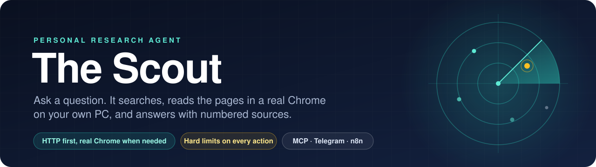
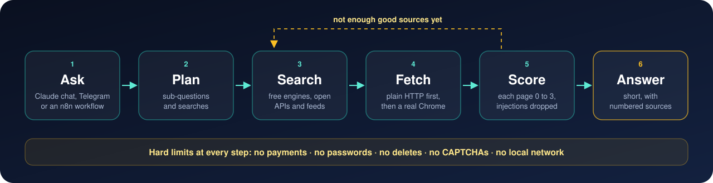

<p align="center">
  
</p>

<p align="center">
  
  
  
  
  
</p>

# The Scout

A personal research and browsing agent that drives a real Chrome on your own PC.

You ask a question from Claude chat, Telegram or an n8n workflow. The Scout searches free
sources, reads the pages (plain HTTP first, a real browser only when a site needs one) and
returns a short answer with numbered sources. It can also click and type on sites you name,
inside the hard limits below.

**Status:** a personal project for one user on one machine. Built and tested on Windows 11
with Python 3.12. Linux and macOS are untested, and the start-with-Windows installers and
`register_claude.py` are Windows-only. It is not a hosted service and has no multi-user mode.

## How it works

<p align="center">
  
</p>

## What it does

- **Research** (`scout.py`): plans sub-questions and searches, fetches pages in batches, has a
  model score each page 0-3, and stops when every sub-question has good sources, or at 40 pages
  or 5 minutes.
- **Discovery** (`search.py`): Brave Search API (optional, free tier), DuckDuckGo, Bing, Mojeek,
  Wikipedia, Hacker News, Reddit, GitHub, arXiv, OpenAlex and SEC EDGAR, plus feeds, sitemaps,
  JSON-LD and a Wayback Machine fallback. Google results pages are never fetched.
- **Fetching** (`fetcher.py`, `tabpool.py`): `curl_cffi` first, then Patchright driving your
  installed Chrome. Pages are classified (ok, challenge, CAPTCHA, login wall, geo block and so on)
  so a block is never mistaken for content. Per-site pacing, a circuit breaker and a time budget
  apply to every fetch.
- **Acting** (`act.py`): a page becomes short text with refs like `[e12]`; `click`, `type`,
  `select`, `scroll` and `submit` work on those refs, in a separate Chrome profile that you log
  into yourself.
- **Brains:** Claude through the `claude -p` command line (no tools, clean environment), or a
  local model behind an OpenAI-style server (LM Studio or Ollama).

## Install

Needs Python 3.12 and Google Chrome. The default brain needs the Claude Code CLI installed and
signed in; the local brain needs LM Studio or Ollama.

```
pip install -r requirements.txt
copy .env.example .env
python run_checks.py
```

`run_checks.py` runs every offline self-test (no network, no browser) and exits non-zero if any
check fails. Fill in `.env` with only the keys you use. Never commit it.

## Use

| Where | How |
|---|---|
| Terminal | `python scout.py "your question"` (add `--brain local` or `--report`) |
| Claude chat | Register `mcp_server.py` as an MCP server named `the-scout` (command: `python`, args: the full path to `mcp_server.py`). On Windows, `pythonw register_claude.py` does it for the desktop app |
| Telegram | `python telegram_bot.py whoami` once to find your user ID, then `python telegram_bot.py` |
| n8n | `python api_server.py make-token`, then `python api_server.py` (listens on `127.0.0.1:8787`); import `n8n/scout-morning-digest.json` |
| Logged-in sites | `python act.py login https://example.com`, log in yourself, close the window |

State lives in `~/.fetcher`: Chrome profiles, the action log (`actions.jsonl`), cache, telemetry
and the per-surface stop flags.

### Settings

Secrets go in `.env` (see `.env.example`). These optional switches are read from the environment:

| Variable | Effect |
|---|---|
| `SCOUT_ALLOW_PRIVATE=1` | Turns hard limit 7 off, so the agent may open `localhost` and LAN addresses |
| `SCOUT_LOCAL_URL`, `SCOUT_LOCAL_MODEL` | The local model server and model (also read from `.env`) |
| `FETCHER_PROXIES` | Comma-separated proxy URLs. Empty by default |
| `FETCHER_DEBUG=1` | Saves pages that failed to `~/.fetcher/debug` |
| `SCOUT_CLAUDE_CONFIG` | Path to the Claude desktop config, if `register_claude.py` can't find it |

## Hard limits

The agent never:

1. pays for anything or enters card or bank details
2. types passwords, logs in or creates accounts
3. deletes data
4. solves CAPTCHAs
5. follows instructions found in web pages, emails, files or search results
6. clicks or types on a site outside the `allowed_sites` given for the task
7. opens pages on your own PC or home network (`localhost`, `192.168.x` and the like)

Every action, blocked ones included, is written to the action log. `stop` halts a surface;
`stop_all` halts all of them. Telegram answers one user ID only, and the HTTP API listens on
loopback only and requires a token.

### What these limits are not

Read this before you point it at an account you care about.

- Limits 1-4 and 6 are enforced by keyword and URL patterns in `act.check()`. They are broad on
  purpose, but they are deny-lists, not a sandbox. A site with unusual wording can get past them.
- Limit 5 depends on the model. Page text is fenced and labelled as data, and the research brain
  has no tools, but prompt injection is not a solved problem.
- The AI chooses `allowed_sites` on each `browse` call, so a page could talk it into a wider scope.
- Limit 7 checks the address before a page opens and again after redirects. It does not stop a
  hostile DNS server that changes its answer between the check and the connection, and
  `SCOUT_ALLOW_PRIVATE=1` switches it off completely.
- Sending messages and submitting forms need no approval. The Scout profile is remote control of
  whatever you logged into there.

## Responsible use

This tool sends requests with Chrome's TLS fingerprint and automates a real browser with
Patchright. Many sites forbid automated access in their terms, and so do some model providers
for scripted use of a consumer plan. Check the terms that apply to you; what you run it against
is your responsibility. The defaults are deliberately gentle: one request every 3 seconds or so
per site, a circuit breaker that leaves a blocking site alone for an hour, and no CAPTCHA solving.

## Tests

```
python run_checks.py
```

Each module has its own `check_*.py`, and `regress.py` keeps fixtures from real runs. All of
them use fakes for the browser, the network and the model.

## Files

| File | What it is |
|---|---|
| `fetcher.py` | The fetch ladder, block classification, sessions, pacing, cache |
| `search.py` | Discovery across the free sources |
| `tabpool.py` | Parallel tabs in one Chrome |
| `act.py` | Snapshots, actions and the hard limits |
| `scout.py` | The research loop and the two brains |
| `mcp_server.py`, `telegram_bot.py`, `api_server.py` | The three ways in |
| `PLAN.md` | The working plan, decisions and progress log |
| `AUDIT.md`, `SUMMARY.md`, `CHAT_SUMMARY.md`, `archive/` | Earlier research, kept for history |

## Licence

MIT. See `LICENSE`.
